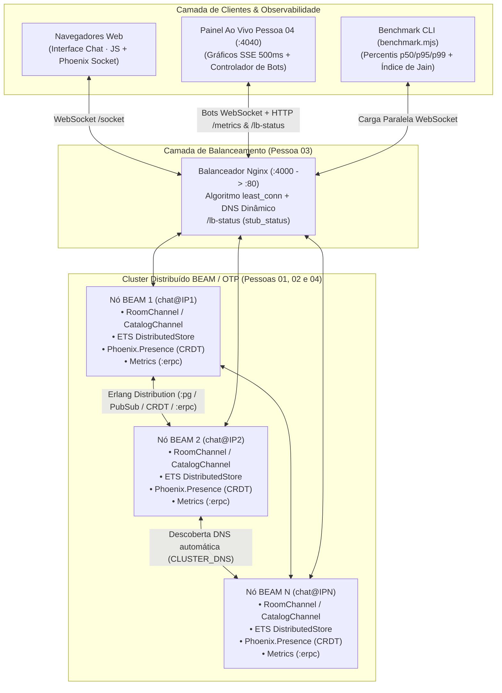

# Entrega Pessoa 04: Observabilidade BEAM, Painel de Métricas Ao Vivo e Benchmark de Escala

Esta etapa conclui o projeto integrando **observabilidade distribuída em tempo real** sobre a máquina virtual Erlang/BEAM, um **Painel Web Interativo com Controlador de Carga Ao Vivo** (`http://localhost:4040`) e uma **bateria científica de benchmarks automatizados** para avaliar throughput, percentis de latência (`p50`, `p95`, `p99`), Índice de Justiça de Jain no balanceamento e isolamento de tópicos `Phoenix.PubSub`.

---

## 1. Arquitetura Completa da Solução (Pessoas 01 a 04)

> **Nota para o Relatório e Slides**: Os diagramas abaixo cobrem os componentes de todas as quatro etapas e podem ser exportados ou colados diretamente na seção *Arquitetura da Solução*.



### Descrição dos Componentes (para o Relatório)
1. **Cliente Web e Transporte (`Pessoa 01`)**: Interface reativa sem dependências externas que mantém canais multiplexados sobre um único WebSocket (`catalog:rooms` para metadados e `room:<id>` para conversas públicas ou privadas protegidas por hash SHA-256).
2. **Cluster BEAM, Catálogo ETS e CRDT Presence (`Pessoa 02`)**:
   - `Cluster.Discovery`: forma a malha de nós Erlang automaticamente via DNS interno do Docker (`CLUSTER_DNS`).
   - `Rooms.DistributedStore`: armazena salas em tabelas `:ets` em memória com `read_concurrency: true` para leituras locais sem gargalo e replica criações assincronamente via `Phoenix.PubSub` (com *anti-entropy dump* quando novos nós entram).
   - `ChatDistribuidoWeb.Presence`: sincroniza a lista de participantes online entre servidores usando CRDTs (*Conflict-free Replicated Data Types*), sem banco central ou *locks* distribuídos.
3. **Balanceador Nginx e Tolerância a Falhas (`Pessoa 03`)**: Ponto único de entrada (`http://localhost:4000`) com política `least_conn` (ideal para conexões persistentes WebSocket) e *failover* passivo (`max_fails=1`, reconexão automática transparente em outro nó vivo quando um container cai).
4. **Sonda Distribuída BEAM, Painel Ao Vivo e Gerador de Carga (`Pessoa 04`)**:
   - `ChatDistribuido.Metrics` (`GET /metrics`): executa `:erpc.multicall/5` nativo do OTP 27 para interrogar simultaneamente todos os nós vivos do cluster, consolidando processos Erlang ativos, memória (`total`, `ets`, `binary`, `processes`), filas de escalonamento (`run_queue`), reduções de CPU da VM, I/O de rede e sessões CRDT por nó.
   - `scripts/painel-metricas.mjs` + `painel-metricas.html` (`http://localhost:4040`): servidor de observabilidade via *Server-Sent Events* (SSE a 500ms) com controlador interativo de estresse multi-salas em tempo real.
   - `scripts/benchmark.mjs` + `scripts/benchmark-escala.sh`: suíte reprodutível de testes de escalonamento horizontal e particionamento de tópicos.

---

## 2. Metodologia de Medição e Conceitos Avaliados

1. **Multiplicação de Fan-out no Broadcast ($O(N^2 / K)$)**:
   - Em um chat em tempo real, quando $C$ clientes divididos igualmente em $K$ salas enviam $M$ mensagens cada, o número total de publicações de entrada é $P = C \times M$, mas o volume real de entregas WebSocket despachadas pelo cluster é:
     $$E = K \times \left(\frac{C}{K}\right) \times \left(\frac{C}{K} \times M\right) = \frac{C^2 \times M}{K}$$
   - Isso demonstra por que particionar conversas em tópicos independentes do `Phoenix.PubSub` reduz quadraticamente o tráfego de saída por sala, permitindo escalar horizontalmente entre os nós.
2. **Latência End-to-End por Percentis (`p50`, `p95`, `p99`)**:
   - Médias simples escondem picos de fila. Cada mensagem gerada pelos bots carrega um carimbo monotônico de alta resolução (`performance.now()`), medindo o tempo exato desde o `ws.send` do remetente, passando pelo Nginx, validação no `RoomChannel`, difusão inter-nós Erlang (`:pg`) e recepção em todos os assinantes da sala.
3. **Índice de Justiça de Jain (*Jain's Fairness Index*)**:
   - Para provar matematicamente que a política `least_conn` do Nginx distribui as conexões WebSocket de forma equilibrada entre os $n$ servidores BEAM ($x_1, x_2, \dots, x_n$ conexões por nó), calculamos:
     $$J(x_1, \dots, x_n) = \frac{\left(\sum_{i=1}^{n} x_i\right)^2}{n \cdot \sum_{i=1}^{n} x_i^2} \in [0, 1]$$
   - Valores próximos de **`1.0000`** comprovam distribuição perfeitamente simétrica entre os servidores.

---

## 3. Como Executar (Linux Local ou Nuvem)

### A. Comando Único para a Apresentação Ao Vivo (`iniciar-apresentacao.sh`)
Na raiz do repositório, o script unificado prepara e valida todo o ambiente (detecta permissões Docker no Linux, expõe portas na rede/VM e aguarda a convergência do cluster):
```console
./iniciar-apresentacao.sh
```
Atalhos práticos durante a demonstração:
```console
./iniciar-apresentacao.sh escalar 6        # Escala de 3 para 6 servidores ao vivo
./iniciar-apresentacao.sh derrubar         # Derruba 1 nó (stop) p/ mostrar reconexão
./iniciar-apresentacao.sh derrubar kill    # Simula queda de energia (SIGKILL)
./iniciar-apresentacao.sh religar          # Religa o nó derrubado
./iniciar-apresentacao.sh status           # Exibe containers e /health
./iniciar-apresentacao.sh parar            # Desliga tudo ao final
```

### B. Hospedado em Container Único na Nuvem (Render, Railway, Fly.io, Cloud Run)
Caso queiram hospedar a demonstração em plataformas PaaS que aceitam apenas **um container e uma única porta HTTP (`$PORT`)**, utilize o `Dockerfile.apresentacao`:
```console
docker build -f Dockerfile.apresentacao -t chat-sd-nuvem .
docker run --rm -p 4000:4000 -p 4040:4040 chat-sd-nuvem
```
Nesse modo, o container inicializa internamente **3 nós BEAM distribuídos reais** (`chat1..3@127.0.0.1`), o **Nginx** e o **Painel de Métricas**, servindo tudo na mesma porta pública:
- `https://seu-app.nuvem/` → Chat Distribuído
- `https://seu-app.nuvem/painel/` → Painel de Métricas & Controlador de Carga Ao Vivo

### C. Subir via Docker Compose Diretamente
```console
docker compose -f compose.lb.yml -f compose.metricas.yml up --build -d
```
- **Chat Distribuído**: [http://localhost:4000](http://localhost:4000)
- **Painel de Métricas & Carga Ao Vivo**: [http://localhost:4040](http://localhost:4040)
- **Endpoint JSON da Telemetria BEAM**: [http://localhost:4000/metrics](http://localhost:4000/metrics)

### D. Rodar a Bateria Automatizada de Benchmark (Gera Tabela pro Relatório)
No Linux / macOS:
```console
sh scripts/benchmark-escala.sh
```
No Windows (PowerShell):
```powershell
.\scripts\benchmark-escala.ps1
```
O script escala o cluster automaticamente (`1`, `3` e `6` nós BEAM), aguarda a convergência do cluster via `/metrics`, executa os testes de escalonamento horizontal e de particionamento de salas (`1 sala` vs. `6 salas`), grava os dados brutos em `docs/resultados-benchmark-p4.json` e imprime no terminal a **tabela Markdown pronta para colar no relatório**.

### E. Rodar Testes Automatizados do Código Elixir
```console
docker compose run --rm -e MIX_ENV=test chat mix test --warnings-as-errors
```

---

## 4. Roteiro para Apresentação Ao Vivo (~2m30s)

1. **Mostrar o Cluster Respirando em Tempo Real (`30s`)**:
   - Projete [http://localhost:4040](http://localhost:4040) ao lado de [http://localhost:4000](http://localhost:4000).
   - Aponte os **3 cartões dos nós BEAM** sendo lidos via `:erpc.multicall`: mostre a quantidade enxuta de memória (~40–50 MB por nó) e processos leves da VM Erlang.
2. **Disparar Carga Multi-Salas e Fan-out (`1m`)**:
   - Clique no botão **`2. Múltiplas Salas (60 bots · 4 salas)`** no topo do painel.
   - Mostre na hora:
     - As salas `Bench Sala 2..4` aparecendo automaticamente na lista lateral do chat e no card **Salas & Presença (CRDT)**.
     - As barras de conexões nos 3 nós BEAM ficando empatadas (`20 / 20 / 20` — `least_conn` funcionando).
     - Depois clique em **`3. Pico Fan-out (120 bots · 1 sala)`** e destaque o salto na curva ciano de **Entregas Broadcast/s** (1 mensagem enviada gera 120 entregas simultâneas com **0 duplicadas** e `p50` de poucos milissegundos!).
3. **Escalonamento ou Queda Ao Vivo no Gráfico (`1m`)**:
   - Com a carga rodando no painel, execute no terminal:
     ```console
     docker compose -f compose.lb.yml -f compose.metricas.yml up -d --scale chat=6
     ```
     *(ou derrube um nó com `docker stop chatsd-chat-2`)*
   - Mostre no painel os novos nós entrando automaticamente no grid (ou o contador **Reconexões** subindo e redistribuindo os bots para os nós sobreviventes sem interromper o gráfico de Throughput!).
   - Finalize clicando em **`Exportar JSON ⬇`** para mostrar os dados consolidados que embasaram o relatório.
